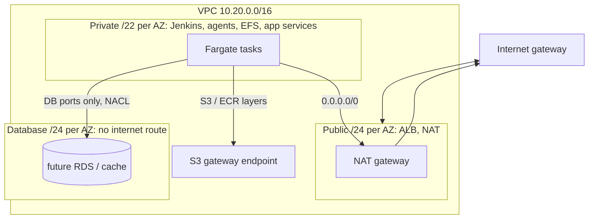

# network module

Builds the VPC for the platform: three subnet tiers across 2–3 AZs, NAT, routing, a locked-down database tier, VPC endpoints and flow logs.

## Layout



| Tier | CIDRs (2 AZs, default VPC) | Route table | Who lives here |
|---|---|---|---|
| Public | `10.20.0.0/24`, `10.20.1.0/24` | `0.0.0.0/0` → IGW | ALBs, NAT gateways |
| Private | `10.20.16.0/22`, `10.20.20.0/22` | `0.0.0.0/0` → NAT | Jenkins controller and agents, EFS, app services |
| Database | `10.20.32.0/24`, `10.20.33.0/24` | local only | RDS / Aurora / ElastiCache |

Subnets are computed with `cidrsubnet()` from `vpc_cidr`, so `az_count = 3` adds the third subnet of each tier with no hand-written CIDRs.

## Design choices

| Choice | Why |
|---|---|
| Private subnets are `/22` | Every Fargate task takes an IP; parallel agents need room. |
| One NAT by default | Saves cost. `single_nat_gateway = false` gives one NAT and route table per AZ, so an AZ failure stays inside that AZ. |
| Database NACL; default NACL elsewhere | Security groups filter the public and private tiers. The database tier also gets a NACL that admits only `database_ports` from the private subnets, so the public tier can never reach a database even if a security group is wrong. |
| Default security group emptied | Nothing can be launched into an open-by-default group by accident. |
| S3 gateway endpoint always on | It is free, and ECR image layers come from S3, so image pulls mostly skip the NAT. |
| Interface endpoints opt-in | Each one bills per hour per AZ. Turn them on to keep ECR, Logs, Secrets Manager, STS and ECS traffic off the NAT. |
| Flow logs on, `ALL` traffic | Network evidence for audits and incident response. The IAM role is limited to one log group and protected against confused-deputy use. |

## Usage

```hcl
module "network" {
  source = "../../modules/network"

  name                 = "platform"
  vpc_cidr             = "10.20.0.0/16"
  az_count             = 2
  single_nat_gateway   = true
  flow_log_kms_key_arn = module.kms.key_arn
}
```

## Tests

`tests/network.tftest.hcl` plans the module against a mocked AWS provider, so it needs no account or credentials:

```bash
terraform init -backend=false
terraform test
```

The tests check:

- the subnet CIDR layout for 2 and 3 AZs
- the NAT and route table count for single and per-AZ NAT
- that the database tier has no internet route and that its NACL admits only the private subnets
- that optional tiers can be turned off
- that a non-/16 VPC CIDR is rejected

<!-- BEGIN_TF_DOCS -->
## Requirements

| Name | Version |
| ---- | ------- |
| terraform | >= 1.10 |
| aws | >= 6.0, < 7.0 |

## Providers

| Name | Version |
| ---- | ------- |
| aws | >= 6.0, < 7.0 |

## Modules

No modules.

## Resources

| Name | Type |
| ---- | ---- |
| [aws_cloudwatch_log_group.flow_logs](https://registry.terraform.io/providers/hashicorp/aws/latest/docs/resources/cloudwatch_log_group) | resource |
| [aws_db_subnet_group.this](https://registry.terraform.io/providers/hashicorp/aws/latest/docs/resources/db_subnet_group) | resource |
| [aws_default_security_group.this](https://registry.terraform.io/providers/hashicorp/aws/latest/docs/resources/default_security_group) | resource |
| [aws_eip.nat](https://registry.terraform.io/providers/hashicorp/aws/latest/docs/resources/eip) | resource |
| [aws_elasticache_subnet_group.this](https://registry.terraform.io/providers/hashicorp/aws/latest/docs/resources/elasticache_subnet_group) | resource |
| [aws_flow_log.this](https://registry.terraform.io/providers/hashicorp/aws/latest/docs/resources/flow_log) | resource |
| [aws_iam_role.flow_logs](https://registry.terraform.io/providers/hashicorp/aws/latest/docs/resources/iam_role) | resource |
| [aws_iam_role_policy.flow_logs](https://registry.terraform.io/providers/hashicorp/aws/latest/docs/resources/iam_role_policy) | resource |
| [aws_internet_gateway.this](https://registry.terraform.io/providers/hashicorp/aws/latest/docs/resources/internet_gateway) | resource |
| [aws_nat_gateway.this](https://registry.terraform.io/providers/hashicorp/aws/latest/docs/resources/nat_gateway) | resource |
| [aws_network_acl.database](https://registry.terraform.io/providers/hashicorp/aws/latest/docs/resources/network_acl) | resource |
| [aws_network_acl_rule.database_egress](https://registry.terraform.io/providers/hashicorp/aws/latest/docs/resources/network_acl_rule) | resource |
| [aws_network_acl_rule.database_ingress](https://registry.terraform.io/providers/hashicorp/aws/latest/docs/resources/network_acl_rule) | resource |
| [aws_route.private_nat](https://registry.terraform.io/providers/hashicorp/aws/latest/docs/resources/route) | resource |
| [aws_route.public_internet](https://registry.terraform.io/providers/hashicorp/aws/latest/docs/resources/route) | resource |
| [aws_route_table.database](https://registry.terraform.io/providers/hashicorp/aws/latest/docs/resources/route_table) | resource |
| [aws_route_table.private](https://registry.terraform.io/providers/hashicorp/aws/latest/docs/resources/route_table) | resource |
| [aws_route_table.public](https://registry.terraform.io/providers/hashicorp/aws/latest/docs/resources/route_table) | resource |
| [aws_route_table_association.database](https://registry.terraform.io/providers/hashicorp/aws/latest/docs/resources/route_table_association) | resource |
| [aws_route_table_association.private](https://registry.terraform.io/providers/hashicorp/aws/latest/docs/resources/route_table_association) | resource |
| [aws_route_table_association.public](https://registry.terraform.io/providers/hashicorp/aws/latest/docs/resources/route_table_association) | resource |
| [aws_security_group.endpoints](https://registry.terraform.io/providers/hashicorp/aws/latest/docs/resources/security_group) | resource |
| [aws_subnet.database](https://registry.terraform.io/providers/hashicorp/aws/latest/docs/resources/subnet) | resource |
| [aws_subnet.private](https://registry.terraform.io/providers/hashicorp/aws/latest/docs/resources/subnet) | resource |
| [aws_subnet.public](https://registry.terraform.io/providers/hashicorp/aws/latest/docs/resources/subnet) | resource |
| [aws_vpc.this](https://registry.terraform.io/providers/hashicorp/aws/latest/docs/resources/vpc) | resource |
| [aws_vpc_endpoint.interface](https://registry.terraform.io/providers/hashicorp/aws/latest/docs/resources/vpc_endpoint) | resource |
| [aws_vpc_endpoint.s3](https://registry.terraform.io/providers/hashicorp/aws/latest/docs/resources/vpc_endpoint) | resource |
| [aws_vpc_security_group_ingress_rule.endpoints_https](https://registry.terraform.io/providers/hashicorp/aws/latest/docs/resources/vpc_security_group_ingress_rule) | resource |
| [aws_availability_zones.available](https://registry.terraform.io/providers/hashicorp/aws/latest/docs/data-sources/availability_zones) | data source |
| [aws_caller_identity.current](https://registry.terraform.io/providers/hashicorp/aws/latest/docs/data-sources/caller_identity) | data source |
| [aws_iam_policy_document.flow_logs_assume](https://registry.terraform.io/providers/hashicorp/aws/latest/docs/data-sources/iam_policy_document) | data source |
| [aws_iam_policy_document.flow_logs_write](https://registry.terraform.io/providers/hashicorp/aws/latest/docs/data-sources/iam_policy_document) | data source |
| [aws_region.current](https://registry.terraform.io/providers/hashicorp/aws/latest/docs/data-sources/region) | data source |

## Inputs

| Name | Description | Type | Default | Required |
| ---- | ----------- | ---- | ------- | :------: |
| name | Name prefix for every resource, e.g. "platform". | `string` | n/a | yes |
| availability\_zones | Optional exact zone names to use (e.g. ["us-east-1a", "us-east-1b"]). Length must equal az\_count. null picks the first az\_count available zones. | `list(string)` | `null` | no |
| az\_count | Number of availability zones to spread subnets across (2 or 3). | `number` | `2` | no |
| create\_elasticache\_subnet\_group | Also create an ElastiCache subnet group on the database subnets. | `bool` | `false` | no |
| database\_ports | TCP ports the database NACL accepts from the private (app) subnets. | `list(number)` | <pre>[<br/>  5432,<br/>  3306,<br/>  6379<br/>]</pre> | no |
| enable\_database\_subnets | Create the isolated database subnet tier (no internet route) and an RDS subnet group. | `bool` | `true` | no |
| enable\_flow\_logs | Send VPC Flow Logs (all traffic) to CloudWatch Logs. | `bool` | `true` | no |
| enable\_interface\_endpoints | Create interface VPC endpoints (billed per hour per AZ). The S3 gateway endpoint is always created because it is free. | `bool` | `false` | no |
| flow\_log\_kms\_key\_arn | KMS key ARN to encrypt the flow log group. The root passes the platform key; null uses CloudWatch's default encryption. | `string` | `null` | no |
| flow\_log\_retention\_days | Retention for the flow log group, in days. | `number` | `365` | no |
| interface\_endpoints | AWS service short names for interface endpoints, used when enable\_interface\_endpoints is true. | `list(string)` | <pre>[<br/>  "ecr.api",<br/>  "ecr.dkr",<br/>  "logs",<br/>  "secretsmanager",<br/>  "sts",<br/>  "ecs"<br/>]</pre> | no |
| single\_nat\_gateway | true = one NAT gateway shared by all AZs (cheaper, single point of failure). false = one NAT per AZ. | `bool` | `true` | no |
| tags | Extra tags merged onto every resource (the provider's default\_tags still apply). | `map(string)` | `{}` | no |
| vpc\_cidr | VPC CIDR block. Must be a /16; subnets are carved from it with a fixed layout (see README). | `string` | `"10.20.0.0/16"` | no |

## Outputs

| Name | Description |
| ---- | ----------- |
| azs | Availability zones used, in subnet order. |
| database\_route\_table\_id | Database route table ID, or null when the tier is disabled. |
| database\_subnet\_cidrs | Database subnet CIDR blocks. |
| database\_subnet\_ids | Isolated database subnet IDs (empty when the tier is disabled). |
| db\_subnet\_group\_name | RDS subnet group name, or null when the database tier is disabled. |
| elasticache\_subnet\_group\_name | ElastiCache subnet group name, or null when not created. |
| endpoints\_security\_group\_id | Security group of the interface endpoints, or null when they are disabled. |
| flow\_log\_group\_name | CloudWatch log group receiving VPC Flow Logs, or null when disabled. |
| nat\_public\_ips | Public IPs of the NAT gateways (useful for allow-lists on third-party APIs). |
| private\_route\_table\_ids | Private route table IDs (one per NAT gateway). |
| private\_subnet\_cidrs | Private subnet CIDR blocks. |
| private\_subnet\_ids | Private subnet IDs (Jenkins, agents, EFS, app services). |
| public\_route\_table\_id | Public route table ID. |
| public\_subnet\_ids | Public subnet IDs (load balancers, NAT). |
| vpc\_cidr | CIDR block of the VPC. |
| vpc\_id | ID of the VPC. |
<!-- END_TF_DOCS -->
